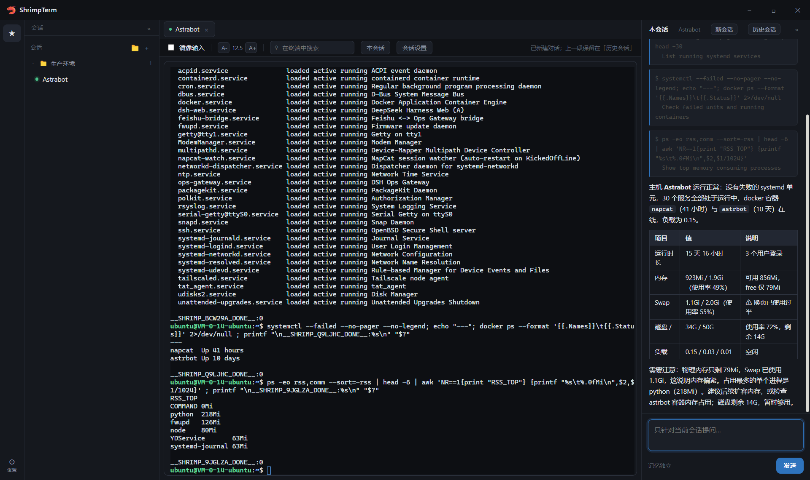

# ShrimpTerm

[](https://github.com/cb-Lobster/shrimp-term/actions/workflows/ci.yml)


一个带 AI 助手的 SSH 客户端。多标签终端 + 每个连接独立的运维助手 —— 所有命令都打在你看得见的终端里。

界面参照极简路线（参考 [Pi Coding Agent](https://pi.dev)）：一个窗口、三个区、零面板堆叠。agent 遵循「能看见它敲什么」——所有命令都打在你看得见的终端里。



## 安装

从 [Releases](https://github.com/cb-Lobster/shrimp-term/releases) 下载 `ShrimpTerm Setup x.y.z.exe`：

- **按当前用户安装**（`%LOCALAPPDATA%\Programs\ShrimpTerm`），不需要管理员权限
- 未做代码签名，SmartScreen 提示「未知发布者」时点 **更多信息 → 仍要运行**
- 运行时数据在 `%APPDATA%\ShrimpTerm`，卸载后保留，重装即恢复连接与设置

也可以从源码跑：

```powershell
npm install
npm start            # 开发运行
npm run check        # 提交前自检（语法 / 回归 / IPC 契约 / 敏感残留）
npm run ship         # 构建并覆盖安装到本机
npm run installer    # 产出 NSIS 安装包
```

## 两个组成部分

| | 位置 | 能做什么 | 记忆 |
|---|---|---|---|
| **终端** | 标签行 | 真 SSH 会话、多标签拖拽排序、镜像输入、可搜索 | — |
| **会话助手** | 右侧「本会话」 | **只能往这一个终端打字** —— 这是唯一能真正操作服务器的通道 | 按连接持久化 |

助手没有任何其他执行通道，这是刻意的限制：它的每一步都发生在你眼前的终端里。

## 技术栈

**零框架。** agent 是一个手写的 tool-calling 循环（`main.js` 里的 `runAgent`，约 90 行），没有 LangChain / CrewAI / RAG / 向量库。

```
渲染进程 (Electron renderer)  ← 无网络权限，全部走 IPC
      │ window.st.ask()
      ▼
主进程 (Node)
      ├── SSH 连接池        ssh2（纯 JS，无原生模块）
      ├── LLM 调用          OpenAI 兼容 /chat/completions
      ├── 工具执行          run_in_terminals → writeTo（只往终端打字）
      └── 回推输出          term:data → 渲染进程显示
```

依赖只有 3 个运行时包：`ssh2`、`iconv-lite`、`@xterm/*`。

## 目录

```
main.js              549 行   主进程：SSH 池、agent 循环、工具、设置/主机/记忆读写
renderer/app.js     1213 行   界面逻辑：终端、标签拖拽、markdown、对话、弹窗、右键菜单
renderer/index.html  633 行   结构与样式（浅/深两套调色板）
preload.js            43 行   安全桥，暴露 22 个 IPC 通道
assets/                       🦐 图标（png / 256px / 7 尺寸 ico）
hosts.example.json            连接配置示例（复制为 hosts.json 后使用）
deploy.ps1                    部署：同步 → 校验 IPC 对齐 → 重启
```

## 工程约定

提交前跑 `npm run check`（语法 + 回归用例 + IPC 对齐 + 敏感残留），需要更新桌面版再跑 `npm run ship`。
十条红线见 [agent.md §0.6](agent.md)。

## 开发与部署

```powershell
# 安装依赖
npm install

# 部署到本机已安装的应用并重启（开发时用这个）
powershell -ExecutionPolicy Bypass -File .\deploy.ps1
```

`deploy.ps1` 会做完这些：停进程 → 复制全部源码和 node_modules → **校验 preload 的每个 IPC 通道在 main 里都有 handler** → 重启。

打包产物的位置：`%LOCALAPPDATA%\Programs\shrimp-term\`。

### 首次运行

会要求填 agent API（OpenAI 兼容）：

```
Base URL   https://api.deepseek.com/v1
API Key    sk-...
模型       deepseek-flash
```

点「测试连接并进入」会真调一次 `/models` 验证；也可以点「稍后设置，先用终端」跳过。

## Agent 工具清单

**只有一个工具。**

```
run_in_terminals(command, note)   ← 往选中的终端里打字，然后等输出
```

助手没有任何其他执行通道：不能读本机文件、不能改应用设置、不能直接连服务器。它想做的事，只能以"在这个终端里敲一条命令"的形式发生，而你能看见每一次敲击。

> 早期版本还有一个"全局助手"，能管理连接、改设置、读所有对话。它已被移除：能力面越宽，可解释性越差；而这个产品的价值就在"看得见"。

## 运行时数据

不在源码里，在安装目录的 `resources/app/` 下：

| 文件 | 内容 | 是否入库 |
|---|---|---|
| `hosts.json` | 连接列表 | **否**（进 `.gitignore`） |
| `settings.json` | 主题、字号、agent API（**API Key 明文存储**，计划改用 `safeStorage`） | **否** |
| `history.json` | 所有 agent 对话记忆 | **否** |

首次使用请复制示例配置：

```bash
cp hosts.example.json hosts.json
```

> ⚠️ **不要把 `hosts.json` 提交到仓库。** 它包含你的服务器地址、用户名与私钥路径。
> 示例里的 `203.0.113.10` / `198.51.100.20` 是 RFC 5737 保留的文档示例地址，不是真实主机。

## 已知问题

1. ~~拿输出靠"等固定时间 + 抓末尾"~~ **已修**：改为哨兵机制——发送 `cmd ; printf "\n<token>:%s\n" "$?"`，轮询 tail 直到出现 token，取 token 之前的输出并解析退出码。快命令立即返回、慢命令不截断、输出已去 ANSI 与回显。代价：依赖 POSIX shell（`printf` / `$?`），Windows 远端需另做适配。
2. **一次只能发一条命令行** —— 多行脚本需要自己用 `&&` / `;` 拼接，或先 `cat > /tmp/x.sh`。
3. **无重试与幂等** —— 同一命令被连发两次就会执行两次。
4. **API Key 明文存 `settings.json`** —— 未用 DPAPI 加密。
5. **不恢复上次打开的标签** —— 重启后要手动重连（记忆还在）。
6. **没有二次确认** —— 助手可以直接执行危险命令；"三闸门"仍是待做项（见 agent.md §5.2）。

## 许可

图标来自 [Microsoft fluentui-emoji](https://github.com/microsoft/fluentui-emoji)（MIT）。
